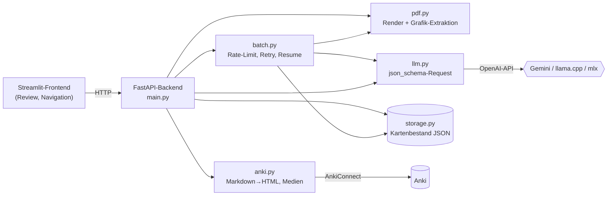

# KI-Lernkarten-Assistent

Erzeugt aus Vorlesungsfolien (PDF) Anki-Karteikarten: Ein multimodales LLM liest jede Folie samt
extrahierter Grafiken und liefert schema-erzwungene Karten, die ein Mensch vor dem Export prüft —
wahlweise mit Gemini, lokalem llama.cpp oder einem selbst feinabgestimmten Vision-Language-Modell.


<!-- Screenshot der Review-Ansicht: docs/screenshot.png -->

## Warum

Aus einem Foliensatz gute Lernkarten zu machen, kostet Stunden — und reine Text-Extraktion
verliert genau das, was Folien ausmacht: Diagramme, Tabellen, Formeln. Dieses Projekt gibt dem
Modell deshalb das **Bild** jeder Folie, lässt Grafiken direkt in die Karten übernehmen und hält
einen Menschen im Prozess: Keine Karte landet in Anki, ohne geprüft zu sein.

## Features

- **Multimodale Generierung pro Folie** — die Folie geht als Bild an ein Vision-Language-Modell;
  Formeln kommen als LaTeX, Code als Codeblock zurück.
- **Grafiken in den Karten** — Raster- und Vektorgrafiken werden deterministisch aus dem PDF
  extrahiert und auf dem Folienbild nummeriert markiert (Set-of-Marks); das Modell referenziert
  sie inline als ``, beim Export landen sie als Anki-Medien in der Karte.
- **Strukturierte Ausgabe per Grammatik-Zwang** — das Pydantic-Schema der Karten geht als
  `json_schema`-`response_format` an den Anbieter, der damit sein Sampling einschränkt; ungültige
  Ausgabe ist nicht erzeugbar statt nachträglich zu parsen.
- **Human-in-the-Loop-Review** — Karten annehmen (= sofort nach Anki exportieren, mit echtem
  Undo), ablehnen, bearbeiten oder mit Feedback neu generieren lassen.
- **Batch-Lauf über ein ganzes PDF** — sequenziell mit Rate-Limiter und Request-Budget,
  Retry pro Folie, Abbruch bei HTTP 429 und Wiederaufnahme genau dort, wo der letzte Lauf stand.
- **Anbieter in der Oberfläche umschaltbar** — Cloud (beliebiger OpenAI-kompatibler Endpunkt),
  llama.cpp oder ein feinabgestimmtes Qwen3-VL-4B über `mlx_vlm`; lokale Server startet und
  stoppt das Backend selbst.

## Architektur



Das **Frontend** ist ein reiner HTTP-Client und importiert nichts aus dem Backend. Das
**Backend** ist bewusst flach: Routen rufen die Module direkt auf, ohne Service-Schicht.
`pdf.get_model_input` ist die eine Stelle, die festlegt, was das Modell sieht — Einzelfolie und
Batch-Lauf können dadurch nicht auseinanderlaufen. Der **Kartenbestand** (eine JSON-Datei
pro PDF) ist die einzige Wahrheit über Karten und Prüfstatus; er wird nach jeder Folie atomar neu
geschrieben, Fortschritt *ist* also die Datei. **Anki** bekommt nur abgeleitetes HTML — die
Karten bleiben als Markdown im Bestand.

## Tech-Stack

| Bereich | Technologie | Warum |
|---|---|---|
| Backend | FastAPI, Pydantic, pydantic-settings | typisierte Routen und Schemata, `/docs` gratis |
| Frontend | Streamlit | schnelle Review-Oberfläche ohne eigenes Web-Frontend |
| LLM-Anbindung | `openai`-Client gegen OpenAI-kompatible Endpunkte | ein Codepfad für Cloud und lokale Modelle |
| Lokale Modelle | llama.cpp (Router-Modus), `mlx_vlm` (LoRA-Adapter) | lokal auf Apple Silicon, ohne API-Kosten |
| PDF | PyMuPDF | Rendering und Grafik-Extraktion deterministisch |
| Anki | AnkiConnect, `markdown` + `pymdown-extensions`, Pygments | MathJax-taugliches LaTeX, Code-Highlighting |
| Tooling | uv, ruff, pytest | Lockfile, Lint, Tests ohne externe Dienste |

## Quickstart

Voraussetzungen: [uv](https://docs.astral.sh/uv/) (installiert Python 3.13 selbst),
ein [kostenloser Gemini-API-Key](https://aistudio.google.com/apikey) und — nur für den Export —
[Anki](https://apps.ankiweb.net/) mit dem Add-on [AnkiConnect](https://ankiweb.net/shared/info/2055492159).

```bash
git clone https://github.com/ericjoelr/KI-Lernkarten-Assistent.git
cd KI-Lernkarten-Assistent
uv sync
cp .env.example .env          # CLOUD_API_KEY und PROVIDER_API_KEY eintragen
```

In zwei Terminals starten:

```bash
uv run uvicorn backend.main:app --reload             # Backend:  http://127.0.0.1:8000/docs
uv run streamlit run src/frontend/streamlit_app.py   # Frontend: http://localhost:8501
```

Im Frontend ein PDF hochladen (oder nach `data/pdf/` legen), eine Folie wählen und
**Karten erzeugen** klicken. Ohne laufendes Anki funktioniert alles außer Deck-Auswahl und
Export; die Oberfläche bietet einen Knopf zum Starten von Anki an.

### Lokale Modelle (optional)

Beide Server startet das Backend selbst, sobald in der Oberfläche ein Modell aktiviert wird;
in der `.env` stehen nur ihre Pfade (`LLAMACPP_SERVER`, `MLX_SERVER`, `MLX_ADAPTERS_DIR`).
llama.cpp bietet alle Bild-Modelle aus dem Hugging-Face-Cache an; bei mlx ist jedes Modell ein
LoRA-Adapter-Ordner. Das feinabgestimmte Modell läuft nur auf Apple Silicon und kennt nur den
Eingabevertrag ohne Grafiken — sein Aktivieren schaltet den Grafik-Modus aus.

## Projektstruktur

```
src/backend/          FastAPI-App: Routen (main.py), LLM, PDF, Anki, Kartenbestand, Batch, Anbieter
src/backend/prompts/  System-Prompt (deutsch) + Grafik-Abschnitt
src/frontend/         Streamlit-Oberfläche; api.py ist der komplette Backend-Vertrag
tests/                pytest, Anki und LLM gedoubelt
```

## Designentscheidungen

- **Grammatik-Zwang statt Prompt-Parsing** —
  `instructor` beschrieb das Schema im Prompt; ein lokales Modell verpackte korrekte Karten
  gelegentlich in einen Markdown-Codeblock. Mit `json_schema` als Sampling-Constraint kann diese
  Ausgabe nicht mehr entstehen.
- **Eine Folie = ein Bild** — Grafiken werden nicht als Extra-Bilder mitgeschickt, sondern auf
  dem Folienbild nummeriert markiert. Billiger und das, was ein kleines feinabgestimmtes Modell
  verarbeiten kann.
- **Eingefrorener Ein-/Ausgabevertrag** — das lokale
  Modell wurde auf genau dieses Format trainiert; flaches Schema, Markdown statt HTML.
- **Kartenbestand in JSON-Dateien statt in Anki** —
  ungeprüfte Karten als Markdown neben Anki statt als Anki-HTML darin: Der Batch-Lauf braucht
  kein laufendes Anki, und dieselbe Datei ist Prüfbestand und Trainingsdatensatz in einem.
- **Kein Modellwechsel im Code** —
  alle Anbieter sprechen die OpenAI-API; das feinabgestimmte Modell kam ohne neue Zeile in `llm.py` dazu.

## Tests

```bash
uv run pytest -q     # 90 Tests, laufen ohne Anki, LLM oder Netzwerk
uv run ruff check .
```

Abgedeckt sind alle Routen über den FastAPI-`TestClient`, die Markdown→Anki-HTML-Umwandlung,
Kartenbestand, Batch-Lauf (mit gefälschter Uhr: Rate-Limit, Retry, 429, Abbruch, Resume) und
die Anbieterwahl. Nicht abgedeckt: die Streamlit-Oberfläche und echte Modellantworten.

## Grenzen und Ausblick

- **Keine automatische Qualitätsmessung der Karten** — Qualität wird heute im Review beurteilt,
  nicht mit einem Evaluations-Set gemessen.
- Die Grafik-Erkennung hält mehrspaltige Textfolien mit Rahmen gelegentlich für eine Grafik.
- Ein Batch-Lauf zur Zeit, Fortschrittsanzeige nur im Prozess (ein Neustart verliert die
  Anzeige, nicht die Karten).
- Lokale Modellserver kommen nach einem Backend-Neustart nicht von selbst zurück.
- Oberfläche, Prompt und Anki-Tags sind deutsch; Code und Kommentare englisch.
- Geplant: Docker-Setup, Tracing der LLM-Aufrufe (Langfuse).

## Kontext

Entstanden als Projekt im Modul *Advanced Natural Language Processing* (2026), parallel zu einem Deep-Learning-Projekt, das das lokale Modell auf mit diesem Tool
erzeugten synthetischen Daten feinabstimmt. Das Folienbild muss dafür in Training und
Inferenz identisch gerendert werden: PyMuPDF, Zoom 1,5, RGB, JPG (`pdf.get_slide_image`).

## Lizenz

[MIT](LICENSE)
