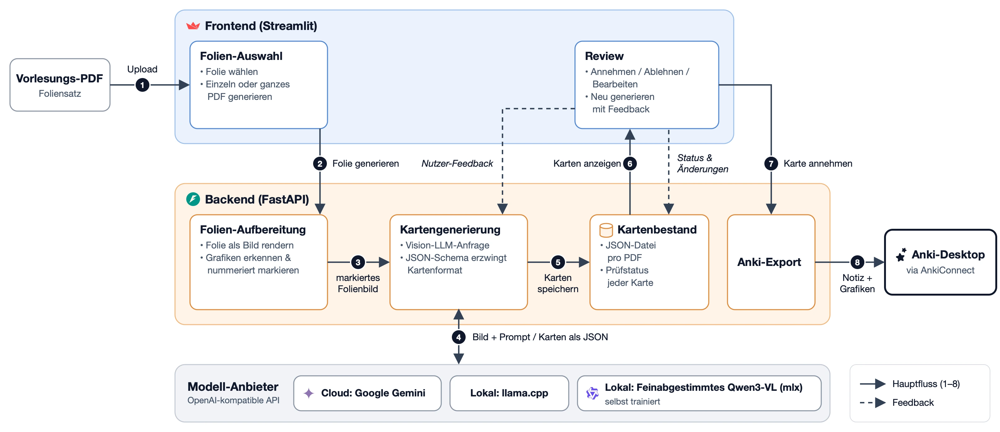

# KI-Karteikarten-Assistent

Erzeugt aus Vorlesungsskripten (PDFs) Karteikarten die direkt in das Lernprogramm Anki exportiert werden können.
Ein multimodales LLM liest jede Folie samt extrahierter Grafiken und liefert schema-erzwungene Karten, die ein Mensch vor dem Export prüft — wahlweise mit Gemini, lokalem llama.cpp oder einem selbst feinabgestimmten Vision-Language-Modell.


## Der Mehrwert

Aus einem Foliensatz gute Karteikarten zu erstellen, kostet Stunden. Inhalt ansehen, eine Frage für die Vorderseite überlegen, den Inhalt auf die Rückseite schreiben, sich mit Diagrammen, mathematischen Formeln oder Tabelle rumschlagen... all das kostet wertvolle Zeit die besser für das Lernen genutzt werden kann.

LLMs können den Kartenerstellungsprozess massiv beschleunigen damit mehr Zeit zum Lernen bleibt. Doch reine Text-Extraktion verliert genau das, was Folien ausmacht: Diagramme, Tabellen, Formeln. Dieses Projekt gibt dem Modell deshalb das **Bild** jeder Folie, lässt Grafiken aus den Folien direkt in die Karten übernehmen und lässt den Nutzer die Karten bewerten, sodass nur validierte Karten wirklich gelernt werden.

Dies funktioniert mit Cloud Modellen als auch lokal mit einem speziell für diese Aufgabe trainiertes Modell (lokal nur mit Apple Silicon). So bleiben die Folien auf deinem Rechner, du kannst den Assistenten auch offline nutzen und du hast keine API-Kosten.

## Die Oberfläche


## Architektur



## Quickstart

Voraussetzungen: [uv](https://docs.astral.sh/uv/)
[Anki](https://apps.ankiweb.net/) mit dem Add-on [AnkiConnect](https://ankiweb.net/shared/info/2055492159).

```bash
git clone https://github.com/ericjoelr/KI-Karteikarten-Assistent.git
cd KI-Karteikarten-Assistent
uv sync
cp .env.example .env          # CLOUD_API_KEY und PROVIDER_API_KEY eintragen
```

In zwei Terminals starten:

```bash
uv run uvicorn backend.main:app --reload             # Backend:  http://127.0.0.1:8000/docs
uv run streamlit run src/frontend/streamlit_app.py   # Frontend: http://localhost:8501
```

Im Frontend ein PDF hochladen (oder nach `data/pdf/` legen), eine Folie wählen und
**Karten erzeugen** klicken. 
Um Karten nach Anki zu exportieren, muss die Anwendung mit installiertem AnkiConnect im Hintergrund aktiv sein.

## Projektstruktur

```
src/backend/          PDF-Verarbeitung, Kartengenererierung und -Speicherung sowie die Anki Schnittstelle
src/backend/prompts/  System-Prompts
src/frontend/         Streamlit-Oberfläche
tests/                Tests für die Backend Logik
```

## Kontext

Entstanden als Projekt im Modul *Advanced Natural Language Processing* (2026), parallel zu einem Deep-Learning-Projekt, in dem das lokale Modell trainiert wurde.

## Lizenz

[MIT](LICENSE)
